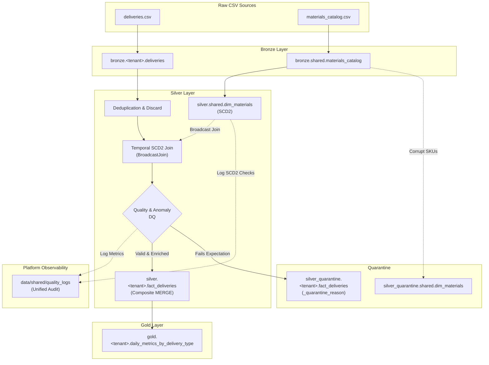

# APEX CHALLENGE - MATIAS BAZAN

[](https://www.python.org/downloads/release/python-3110/)
[](https://delta.io/)
[](https://spark.apache.org/)
[](https://opensource.org/licenses/MIT)

A portable, **Multi-Tenant Medallion Lakehouse Pipeline** built with **PySpark** and **Delta Lake**

The architecture guarantees tenant isolation, master data synchronization (SCD Type 2), deterministic quarantine routing for anomalous records, zero-dependency declarative quality gates (`fail_fast`, `fail_on_critical`), and dual-runtime compatibility (Local WSL/Linux development and Databricks Asset Bundles/Serverless)

---

## Table of Contents

- [Architectural Overview](#architectural-overview)
- [Storage Topology & Namespace Isolation](#storage-topology--namespace-isolation)
- [Medallion Layers](#medallion-layers)
  - [Bronze Layer (Raw Ingestion)](#bronze-layer-raw-ingestion)
  - [Silver Layer (Curated & Master Data)](#silver-layer-curated--master-data)
  - [Quarantine Routing & Anomaly Handling](#quarantine-routing--anomaly-handling)
  - [Gold Layer (Business Aggregates)](#gold-layer-business-aggregates)
- [Declarative Data Quality Engine](#declarative-data-quality-engine)
- [Project Structure](#project-structure)
- [Local Development Setup](#local-development-setup)
- [CLI & Pipeline Execution](#cli--pipeline-execution)
- [Testing & Quality Verification](#testing--quality-verification)
- [CI/CD & Databricks Portability](#cicd--databricks-portability)

---



---

## Storage Topology & Namespace Isolation

To balance tenant data privacy with analytical efficiency, storage boundaries are partitioned as follows:

| Layer | Physical Path (Local) | Databricks / Unity Catalog Target | Partitioning Strategy | Access Scope |
| :--- | :--- | :--- | :--- | :--- |
| **Bronze Catalog** | `data/bronze/shared/materials_catalog` | `saas_<env>.bronze_shared.materials_catalog` | None (low cardinality) | Shared |
| **Bronze Deliveries** | `data/bronze/<tenant>/deliveries` | `saas_<env>.bronze_<tenant>.deliveries` | `tenant_id` + `fecha_proceso` | Isolated per tenant |
| **Silver Dimension** | `data/silver/shared/dim_materials` | `saas_<env>.silver_shared.dim_materials` | None (unpartitioned master data) | Shared |
| **Silver Fact** | `data/silver/<tenant>/fact_deliveries` | `saas_<env>.silver_<tenant>.fact_deliveries` | `fecha_proceso` | Isolated per tenant |
| **Silver Quarantine**| `data/silver_quarantine/<tenant>/...` | `saas_<env>.silver_quarantine_<tenant>...` | `_quarantine_reason` (optional) | Isolated per tenant |
| **Quality Audit** | `data/shared/quality_logs` | `saas_<env>.shared.quality_logs` | None | Shared platform audit |

---

## Medallion Layers

### Bronze Layer (Raw Ingestion)
- **Streaming Ingestion**: Utilizes (`readStream`) backed by schema hints to ingest raw CSV source files idempotently into Delta.
- **Audit Lineage Columns**: Appends technical audit columns to every record:
  - `_source_file`: Origin file URI
  - `_ingestion_timestamp`: UTC timestamp
  - `_batch_id`: Ingestion run identifier
  - `_tenant_id`: Parsed tenant code

### Silver Layer (Curated & Master Data)
1. **Shared Dimension (`dim_materials` - SCD2)**:
   - Tracks historical SKU price and descriptor mutations across validity windows (`valid_from` to `valid_to`)
   - Reconciles `is_current` to guarantee that **strictly one record per SKU** has `is_current = True` (with `valid_to = '9999-12-31'`)
   - Upsert idempotently using `MERGE INTO` on `(material, valid_from)`
2. **Tenant Fact (`fact_deliveries`)**:
   - **Exact Deduplication**: Drops identical records across business columns recording drop metrics to `quality_logs`
   - **Business Discard**: Filters non-delivery activity (`tipo_entrega` not in `['ZPRE', 'ZVE1', 'Z04', 'Z05']`, such as collection records `COBR` and test records `Z99`)
   - **Unit Normalization**: Standardizes cases to units (`CS` $\to$ `ST` via factor $\times 20$) into `cantidad_normalizada_st`.
   - **Delivery Type Flags**: Derives `is_routine_delivery` (`ZPRE`, `ZVE1`) and `is_bonus_delivery` (`Z04`, `Z05`).
   - **Temporal SCD2 Join**: Enriches fact deliveries against `dim_materials` using an explicit Broadcast Hash Join (`F.broadcast(dim_materials)`) `fact_deliveries.fecha_proceso BETWEEN dim_materials.valid_from AND dim_materials.valid_to`
   - **Idempotent Merge**: Upserts into Delta on the 6-column composite key:
     $$\text{Key} = (\text{tenant\_id}, \text{fecha\_proceso}, \text{transporte}, \text{ruta}, \text{material}, \text{tipo\_entrega})$$

### Quarantine & Anomaly Handling
Records failing business or relational contracts are extracted before persistence into Silver facts:
- **`INVALID_FECHA_PROCESO`**: Null, unparseable, or invalid dates (e.g., `00000000`, `20251332`).
- **`INVALID_CANTIDAD`**: Quantity $\le 0$ or null.
- **`INVALID_PRECIO`**: Price $\le 0$ or null.
- **`UNMAPPED_MATERIAL`**: SKU not found in catalog or active validity window.

Anomalies are tagged with pipe-delimited failure reasons (`_quarantine_reason`) via `F.array_compact` and written to `data/silver_quarantine/<tenant>/fact_deliveries`.

---

## Declarative Data Quality Engine

To eliminate dependency conflicts across environments and Databricks runtimes, this pipeline implements a **zero-dependency, PySpark-native DQ checks**

Rules evaluate in a single vectorized aggregation pass and append execution metrics to `data/shared/quality_logs` adhering to the standard schema:

```sql
_run_id STRING,
_batch_id STRING,
tenant_id STRING,
layer STRING,
table_name STRING,
check_name STRING,
check_severity STRING,   -- 'critical' | 'warning' | 'info'
records_checked LONG,
records_failed LONG,
check_passed BOOLEAN,
executed_at TIMESTAMP
```

### Quality Control Gates
- **`execution.fail_fast`**: When enabled, an unhandled exception or tenant-level failure halts multi-tenant batch iterations immediately.
- **`quality.fail_on_critical`**: When enabled (`dev: false`, `qa/main: true`), any check where `check_severity == 'critical'` and `records_failed > 0` raises `CriticalDQException`, aborting the pipeline before downstream layer execution.

---

## Project Structure

```text
├── config/
│   ├── base.yaml                    # Base schema, tenant lists, business rules
│   └── env/
│       ├── dev.yaml                 # Local sandbox paths, fail_on_critical=false
│       ├── qa.yaml                  # Staging configs, fail_on_critical=true
│       └── main.yaml                # Production paths & strict quality gates
│
├── data/                            # Local lakehouse storage (Git-ignored)
│   ├── raw/                         # Source CSV drops (deliveries, materials)
|   └── dev/
│       ├── bronze/                  # Raw Delta tables
│       ├── silver/                  # Curated clean Delta tables
│       ├── silver_quarantine/       # Isolated anomaly Delta tables
│       └── shared/                  # quality_logs Delta table
│
├── src/
│   └── saas_pipeline/
│       ├── __init__.py
│       ├── cli.py                   # Click CLI entrypoint
│       │
│       ├── common/                  # Foundational cross-cutting utilities
│       │   ├── config.py            # OmegaConf hierarchical loader & CLI overrides
│       │   ├── delta.py             # Delta tables functions
│       │   ├── quality_log.py       # PySpark rule evaluator & quality_logs engine
│       │   └── spark.py             # SparkSession builder with Delta Lake extensions
│       │
│       ├── bronze/                  # Bronze streaming ingestion
│       │   ├── deliveries.py        # Raw delivery event ingestion
│       │   └── materials.py         # Raw material catalog ingestion
│       │
│       └── silver/                  # Silver transformation & master data
│           ├── deliveries.py        # Deduplication, quarantine, temporal join, fact merge
│           ├── delivery_quality_rules.py
│           └── materials.py         # SCD Type 2 merge & catalog quarantine
│
├── tests/
│   ├── conftest.py                  # Pytest fixtures & session-scoped SparkSession
│   ├── test_config.py               # OmegaConf inheritance & interpolation tests
│   ├── test_bronze.py               # Streaming ingestion unit tests
│   ├── test_dq.py                   # Quality engine & fail_on_critical tests
│   ├── test_silver.py               # SCD2 dim merge and deliveries fact unit tests
│   └── test_e2e_silver.py           # Full real-dataset (3,115 rows) E2E integration test
│
├── .github/
│   └── workflows/
│       └── ci.yml                   # CI: lint, config validation, wheel build, pytest
├── Makefile                         # Unified developer automation commands
└── pyproject.toml                   # Project metadata, dependencies, and tools
```

---

## Local Development Setup

### Prerequisites
- **Linux or WSL2** *(Ubuntu >= 24.04)*
- **Python 3.11**
- **Java >= 17 (OpenJDK)**:
- **uv** *(same as Databricks DABs)*:

### Installation
Clone the repository and initialize the virtual environment:
```bash
git clone <repo-url>
cd saas-pipeline

# Setup venv and install packages
make setup
```

---

## CLI & Pipeline Execution

Execute the pipeline using either `make` targets or direct CLI invocations:

### 1. Ingest Bronze Layer
```bash
# Ingest all tenants
make run-bronze

# Or invoke the CLI directly for a specific tenant
uv run saas-pipeline --env dev --tenant sv --layer bronze
```

### 2. Execute Silver Layer
```bash
# Run Silver transformations, SCD2 merges and quarantine routing
make run-silver

# Run with explicit quality gate overrides
uv run saas-pipeline --env dev --tenant all --layer silver --fail-fast --fail-on-critical
```

---

## Testing & Quality Verification

The test harness separates fast CI unit tests from comprehensive end-to-end integration runs:

```bash
# 1. Run Ruff Linter & Formatting Check
make lint

# 2. Automatically Fix Formatting & Lint Issues
make fix-lint

# 3. Run Fast Unit Tests (executed on PR in GitHub Actions)
make test

# 4. Run full end-to-end Test (against provided CSVs)
make test-e2e
```

---

## CI/CD & Databricks Portability

The pipeline is intentionally built without proprietary vendor dependencies:
1. **GitHub Actions (`.github/workflows/ci.yml`)**:
   - Runs linting and format enforcement (`ruff`).
   - Validates multi-environment OmegaConf (`dev`, `qa`, `main`).
   - Runs the isolated unit test suite on Linux GH runner.
2. **Databricks Deployment**:
   - The local filesystem runtime is implemented and tested.
   - Databricks/Unity Catalog paths are scaffolded in configuration, while
     Terraform provisioning, Azure cloud and DAB bundle deployment remain follow-up work.
     See [`docs/tenant-onboarding-terraform.md`](docs/tenant-onboarding-terraform.md)
     for the onboarding approach.
